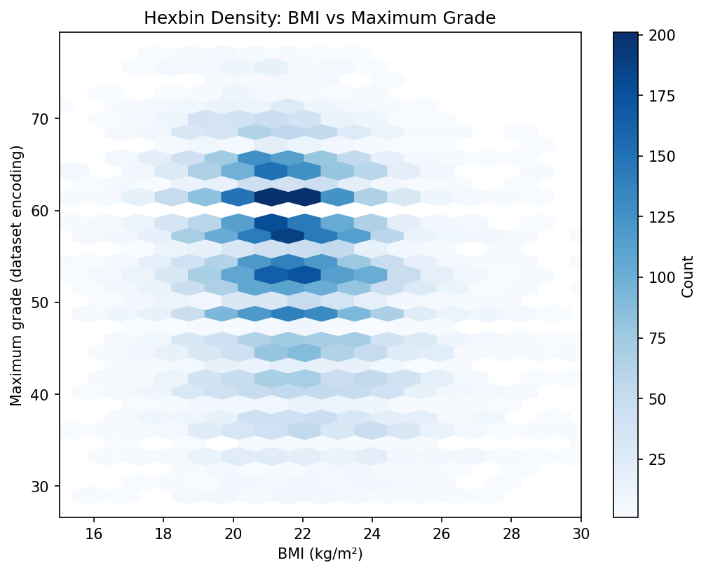

# Climbing Data Analysis

Exploratory Python analysis of the climber records in `climbingModel/data/climber_df.csv`. The script computes BMI from recorded height and weight, summarizes relationships with the dataset's grade fields, and exports plots and statistics. It does not train a predictive model.

## Reproduce the analysis

Use Python 3.11 or newer.

```sh
python3 -m venv .venv
. .venv/bin/activate
pip install -r requirements.txt
MPLBACKEND=Agg python climbingModel/climbing.py
python -m unittest discover -s tests -v
```

The default input and output paths are resolved relative to the script, so the command also works from another working directory. Figures are saved without opening interactive windows. Add `--show` for interactive display, or specify your own paths:

```sh
python climbingModel/climbing.py --csv path/to/input.csv --outdir output
```

## Outputs

| Output | Contents |
| --- | --- |
| `corr_matrix.csv` | Pearson correlations among recorded size and grade fields |
| `hexbin_bmi_vs_max.png` and counts CSV | Density of BMI and maximum-grade observations |
| `bmi_sex.png` and statistics | Groups using the dataset's 0/1 sex encoding |
| `bmi_age.png` and statistics | Left-closed age groups: under 25, 25-34, 35-44, 45-54, and 55+ |
| `country_boxplot.png` and statistics CSV | Maximum-grade distributions for the ten largest country groups |



The plotted BMI window is 15-30; the CSV statistics use all retained valid observations. Sparse or constant groups do not receive an invalid regression fit. Rows with non-positive or non-finite height or weight, or a non-finite maximum grade, are excluded. Invalid ages are excluded from age groups while remaining eligible for other summaries.

## Interpretation and data provenance

The repository does not record the original dataset source, license, sampling process, measurement definitions, or grade-to-scale mapping. Grade numbers are therefore labeled as dataset encodings. The script retains the original labels for the sex encoding, which have not been independently verified. Establish provenance and reuse rights before redistributing or extending the data.

These are descriptive associations in the included records. They cannot establish causation, predict an individual climber's performance, or support health or weight recommendations. Selection effects, missing records, and unmeasured factors remain unresolved.

## Validation

Tests cover age boundaries, invalid physical measurements, missing columns, and sparse or constant groups. The workflow also runs the complete export with a non-interactive plotting backend.
